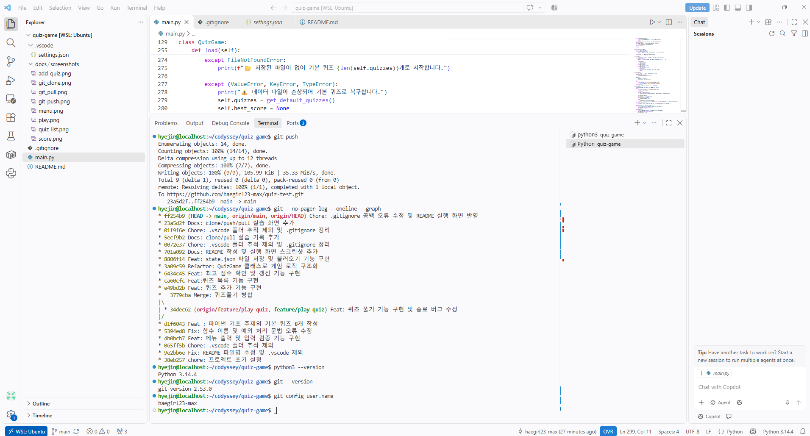
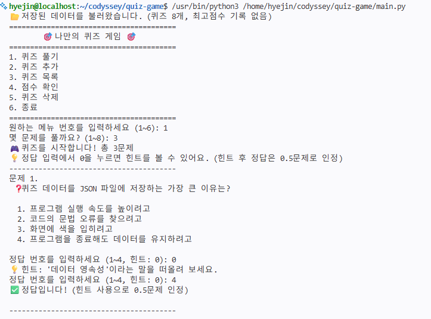
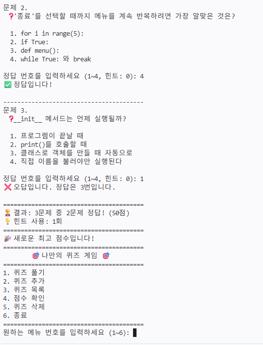
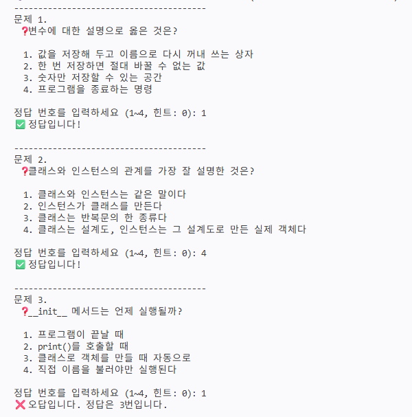
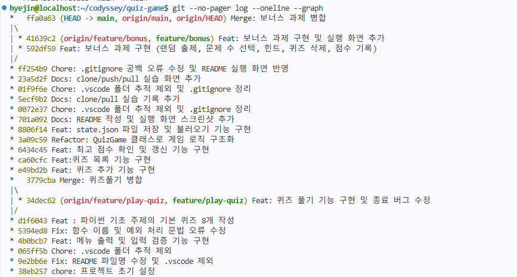
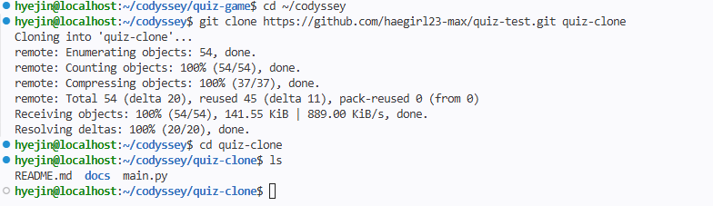
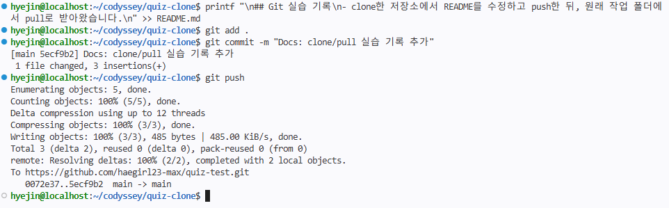
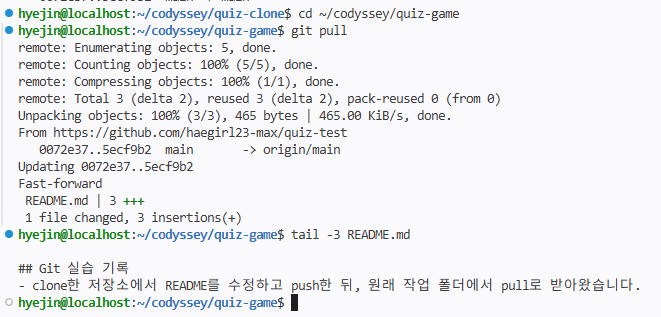

# 🎯 나만의 퀴즈 게임

## 프로젝트 개요
터미널에서 실행하는 **파이썬 기초 개념 퀴즈 게임**입니다.
메뉴에서 번호를 선택해 퀴즈 풀기, 퀴즈 추가, 퀴즈 목록 보기, 점수 확인, 퀴즈 삭제를 할 수 있으며,
추가한 퀴즈와 최고 점수, 게임 기록은 `state.json` 파일에 저장되어 프로그램을 다시 실행해도 유지됩니다.

- 언어: Python 3.10 이상 (표준 라이브러리 `json`, `random`, `datetime`만 사용)
- 구조: `Quiz`(퀴즈 한 문제), `QuizGame`(게임 전체 관리) 2개의 클래스로 역할 분리
- 보너스 과제 5개(랜덤 출제, 문제 수 선택, 힌트, 퀴즈 삭제, 점수 기록 히스토리) 구현

## 퀴즈 주제 선정 이유
2주차 시험에 대비하기 위해 파이썬 기본 개념 문제로 퀴즈를 구성했습니다.
변수, 자료형, 조건문, 반복문, 함수, 클래스, 파일 입출력(JSON), 예외 처리 등
입학 연수에서 배운 핵심 개념을 퀴즈로 반복해서 풀어 보며 복습할 수 있도록 했습니다.

## 개발 환경
| 항목 | 내용 |
|---|---|
| OS | Windows + WSL (Ubuntu) |
| 에디터 | Visual Studio Code (Python 확장) |
| Python | 3.14.4 |
| Git | 2.53.0 |



## 실행 방법
```bash
# 1. 저장소 복제
git clone https://github.com/haegirl23-max/quiz-test.git
cd quiz-test

# 2. 실행 (Python 3.10 이상)
python3 main.py
```

## 기능 목록
| 메뉴 | 기능 | 설명 |
|---|---|---|
| 1 | 퀴즈 풀기 | 풀 문제 수를 고르면 퀴즈를 **무작위 순서**로 출제하고, 정답/오답과 최종 점수(100점 만점)를 보여줍니다. 최고 점수를 넘으면 갱신하고, 게임 기록을 저장합니다. |
| 2 | 퀴즈 추가 | 문제, 선택지 4개, 정답 번호, 힌트(선택)를 입력받아 새 퀴즈를 등록합니다. |
| 3 | 퀴즈 목록 | 등록된 퀴즈의 문제 목록을 번호와 함께 보여줍니다. |
| 4 | 점수 확인 | 최고 점수와 최근 게임 기록(최대 5개, 최신순)을 보여줍니다. |
| 5 | 퀴즈 삭제 | 번호를 골라 퀴즈를 삭제하고 파일에 반영합니다. (0: 취소, 삭제 전 y/n 확인) |
| 6 | 종료 | 데이터를 저장하고 프로그램을 종료합니다. |

### 보너스 과제 구현 내용
| 보너스 과제 | 구현 방법 |
|---|---|
| 1. 랜덤 출제 | `random.sample()`로 퀴즈 목록에서 겹치지 않게 무작위로 뽑아 출제 순서를 섞습니다. |
| 2. 문제 수 선택 | 퀴즈 풀기 시작 시 `1 ~ 등록된 퀴즈 수` 범위에서 풀 문제 수를 입력받습니다. |
| 3. 힌트 기능 | `Quiz` 클래스에 `hint` 속성을 추가했습니다. 정답 입력에서 `0`을 누르면 힌트를 보여주며, 힌트를 본 뒤 맞히면 **0.5문제**로만 인정해 점수가 차감됩니다. |
| 4. 퀴즈 삭제 | 메뉴 5번에서 번호로 퀴즈를 골라 확인 후 삭제하고, 즉시 `state.json`에 저장합니다. |
| 5. 점수 기록 히스토리 | 게임을 마칠 때마다 날짜/시간, 푼 문제 수, 맞힌 수, 힌트 사용 수, 점수를 기록해 `state.json`에 저장합니다. |

**점수 계산**: `점수 = (힌트 없이 맞힌 문제 × 1 + 힌트 보고 맞힌 문제 × 0.5) ÷ 푼 문제 수 × 100` (소수점 버림)

### 보너스 기능 실행 화면
**① 문제 수 선택 + 힌트 사용**: 6개 메뉴에서 1번을 고르고 3문제를 선택한 뒤, 첫 문제에서 `0`을 눌러 힌트를 보고 맞혀 0.5문제로 인정된 화면입니다.



**② 결과와 점수 차감**: 3문제 중 2문제를 맞혔지만 힌트를 1회 사용해 `(0.5 + 1 + 0) ÷ 3 × 100 = 50점`으로 계산되고, 최고 점수가 갱신된 화면입니다.



**③ 랜덤 출제**: 같은 3문제 풀기를 다시 실행했을 때 ①과 다른 문제가 다른 순서로 출제된 화면입니다.



### 입력 및 예외 처리
- 입력값 앞뒤 공백 제거 (예: ` 1 ` → `1`)
- 숫자가 아닌 입력(예: `abc`), 범위 밖 숫자(예: `9`), 빈 입력 → 안내 메시지 후 다시 입력
- `Ctrl+C` / 입력 종료(EOF) → 비정상 종료 없이 데이터를 저장하고 종료
- 퀴즈가 없을 때 풀기·목록·삭제 선택, 퀴즈를 풀기 전 점수 확인 → 안내 메시지 출력
- 힌트가 없는 문제에서 `0` 입력 → "이 문제에는 힌트가 없습니다" 안내

## 실행 화면
> 아래 화면은 필수 기능 구현 단계에서 캡처한 것으로, 보너스 기능 추가 후 메뉴 구성(6번 종료)과 일부 안내 문구가 다를 수 있습니다. 보너스 기능을 반영한 화면은 위의 [보너스 기능 실행 화면](#보너스-기능-실행-화면)을 참고하세요.

### 메뉴


### 퀴즈 풀기


### 퀴즈 추가


### 퀴즈 목록


### 점수 확인


## 파일 구조
```
quiz-test/
├── main.py        # 프로그램 전체 코드 (Quiz, QuizGame 클래스 및 입력 처리 함수)
├── README.md      # 프로젝트 설명 문서
├── .gitignore     # Git에서 제외할 파일 목록 (.vscode/, state.json 등)
├── docs/
│   └── screenshots/   # README에 사용하는 화면 캡처
│       ├── dev_env.png
│       ├── menu.png
│       ├── play.png
│       ├── add_quiz.png
│       ├── quiz_list.png
│       ├── score.png
│       ├── bonus_hint.png
│       ├── bonus_result.png
│       ├── bonus_random.png
│       ├── git_clone.png
│       ├── git_push.png
│       ├── git_pull.png
│       └── git_log.png
└── state.json     # 실행 중 자동 생성되는 데이터 파일 (Git에는 올리지 않음)
```

### main.py 구성
| 이름 | 종류 | 역할 |
|---|---|---|
| `Quiz` | 클래스 | 퀴즈 한 문제 (문제, 선택지, 정답, 힌트 / 출력, 정답 확인, 힌트 유무 확인, dict 변환) |
| `QuizGame` | 클래스 | 게임 전체 (퀴즈 목록, 최고 점수, 게임 기록 / 메뉴, 풀기, 추가, 목록, 삭제, 점수, 저장, 불러오기) |
| `get_default_quizzes()` | 함수 | 힌트가 포함된 기본 퀴즈 8개 생성 |
| `get_number()` / `get_text()` | 함수 | 숫자·글자 입력을 안전하게 받는 공통 입력 함수 |

## 데이터 파일 설명 (`state.json`)
- **경로**: 프로젝트 루트의 `state.json` (`main.py`와 같은 폴더)
- **역할**: 퀴즈 목록, 최고 점수, 게임 기록을 저장하여 프로그램을 종료했다 다시 실행해도 데이터가 유지되도록 합니다.
- **인코딩**: UTF-8
- **저장 시점**: 퀴즈 추가·삭제 후, 퀴즈 풀기를 마쳤을 때, 종료(메뉴 6번 또는 `Ctrl+C`) 시
- **예외 처리**
  - 파일이 없으면(첫 실행) 기본 퀴즈 8개로 시작합니다.
  - 파일이 손상되었으면 안내 메시지를 출력하고 기본 퀴즈로 복구합니다.
  - `hint`, `history`가 없는 이전 형식의 파일도 그대로 불러올 수 있습니다. (힌트는 빈 값, 기록은 빈 목록으로 처리)

### 스키마
```json
{
  "quizzes": [
    {
      "question": "변수에 대한 설명으로 옳은 것은?",
      "choices": ["선택지1", "선택지2", "선택지3", "선택지4"],
      "answer": 1,
      "hint": "score = 0 처럼 이름을 붙여 값을 담아 두는 것을 떠올려 보세요."
    }
  ],
  "best_score": 100,
  "history": [
    {
      "date": "2026-11-10 15:30",
      "total": 5,
      "correct": 4,
      "hints": 1,
      "score": 70
    }
  ]
}
```
| 키 | 타입 | 설명 |
|---|---|---|
| `quizzes` | list | 퀴즈 목록 |
| `quizzes[].question` | str | 문제 |
| `quizzes[].choices` | list (str 4개) | 선택지 |
| `quizzes[].answer` | int (1~4) | 정답 번호 |
| `quizzes[].hint` | str | 힌트 (없으면 빈 문자열 `""`) |
| `best_score` | int 또는 null | 최고 점수 (100점 만점, 아직 풀지 않았으면 `null`) |
| `history` | list | 게임 기록 목록 (오래된 순) |
| `history[].date` | str | 게임을 마친 날짜/시간 (`YYYY-MM-DD HH:MM`) |
| `history[].total` | int | 푼 문제 수 |
| `history[].correct` | int | 맞힌 문제 수 |
| `history[].hints` | int | 힌트 사용 횟수 |
| `history[].score` | int | 점수 (100점 만점) |

## Git 실습 기록
### 브랜치 생성 및 병합
`feature/play-quiz` 브랜치에서 퀴즈 풀기 기능을 구현한 뒤 `main`에 `--no-ff`로 병합했습니다.
보너스 과제는 `feature/bonus` 브랜치에서 작업한 뒤 `main`에 병합했습니다.



### clone / pull 실습
GitHub 저장소를 별도 폴더(`quiz-clone`)에 복제한 뒤, 복제한 저장소에서 README를 수정해 `push`하고,
원래 작업 폴더(`quiz-game`)에서 `pull`로 변경사항을 받아왔습니다.

**1. `git clone`: 별도 폴더(`quiz-clone`)에 저장소 복제**



**2. 복제한 저장소에서 README 수정 후 `commit`, `push`**



**3. `git pull`: 원래 작업 폴더(`quiz-game`)에서 변경사항 받아오기**



### 사용한 Git 명령어
`init`, `add`, `commit`, `push`, `checkout`, `merge`, `clone`, `pull`
