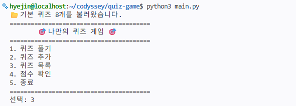
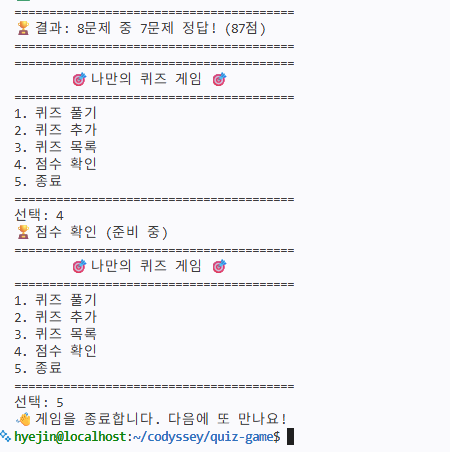
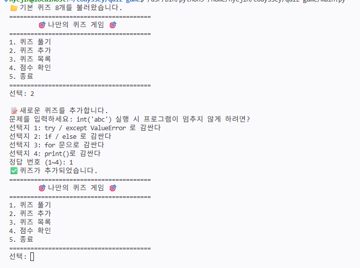
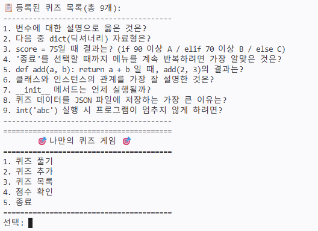
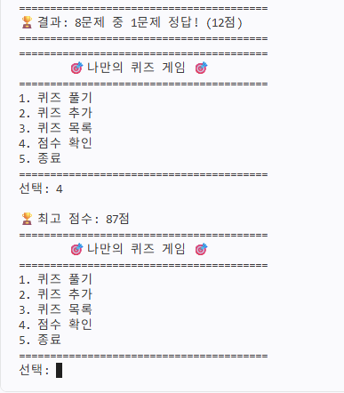

# 🎯 나만의 퀴즈 게임

## 프로젝트 개요
터미널에서 실행하는 **파이썬 기초 개념 퀴즈 게임**입니다.
메뉴에서 번호를 선택해 퀴즈 풀기, 퀴즈 추가, 퀴즈 목록 보기, 최고 점수 확인을 할 수 있으며,
추가한 퀴즈와 최고 점수는 `state.json` 파일에 저장되어 프로그램을 다시 실행해도 유지됩니다.

- 언어: Python 3.10 이상 (표준 라이브러리만 사용)
- 구조: `Quiz`(퀴즈 한 문제), `QuizGame`(게임 전체 관리) 2개의 클래스로 역할 분리

## 퀴즈 주제 선정 이유
2주차 시험에 대비하기 위해 파이썬 기본 개념 문제로 퀴즈를 구성했습니다.
변수, 자료형, 조건문, 반복문, 함수, 클래스, 파일 입출력(JSON), 예외 처리 등
입학 연수에서 배운 핵심 개념을 퀴즈로 반복해서 풀어 보며 복습할 수 있도록 했습니다.

## 실행 방법
```bash
# 1. 저장소 복제
git clone https://github.com/haegirl23-max/quiz-test.git
cd quiz-test

# 2. 실행 (Python 3.10 이상)
python3 main.py
```

## 실행 화면
### 메뉴


### 퀴즈 풀기


### 퀴즈 추가


### 퀴즈 목록


### 점수 확인


## 기능 목록
| 메뉴 | 기능 | 설명 |
|---|---|---|
| 1 | 퀴즈 풀기 | 등록된 퀴즈를 차례로 출제하고 정답/오답과 최종 점수(100점 만점)를 보여줍니다. 최고 점수를 넘으면 갱신합니다. |
| 2 | 퀴즈 추가 | 문제, 선택지 4개, 정답 번호를 입력받아 새 퀴즈를 등록합니다. |
| 3 | 퀴즈 목록 | 등록된 퀴즈의 문제 목록을 번호와 함께 보여줍니다. |
| 4 | 점수 확인 | 지금까지의 최고 점수를 보여줍니다. |
| 5 | 종료 | 데이터를 저장하고 프로그램을 종료합니다. |

### 입력 및 예외 처리
- 입력값 앞뒤 공백 제거 (예: ` 1 ` → `1`)
- 숫자가 아닌 입력(예: `abc`), 범위 밖 숫자(예: `9`), 빈 입력 → 안내 메시지 후 다시 입력
- `Ctrl+C` / 입력 종료(EOF) → 비정상 종료 없이 데이터를 저장하고 종료
- 퀴즈가 없을 때 풀기·목록 선택, 퀴즈를 풀기 전 점수 확인 → 안내 메시지 출력

## 파일 구조
```
quiz-test/
├── main.py        # 프로그램 전체 코드 (Quiz, QuizGame 클래스 및 입력 처리 함수)
├── README.md      # 프로젝트 설명 문서
├── .gitignore     # Git에서 제외할 파일 목록
├── docs/
│   └── screenshots/   # README에 사용하는 실행 화면 캡처
│       ├── menu.png
│       ├── play.png
│       ├── add_quiz.png
│       ├── quiz_list.png
│       └── score.png
└── state.json     # 실행 중 자동 생성되는 데이터 파일 (Git에는 올리지 않음)
```

### main.py 구성
| 이름 | 종류 | 역할 |
|---|---|---|
| `Quiz` | 클래스 | 퀴즈 한 문제 (문제, 선택지, 정답 / 출력, 정답 확인, dict 변환) |
| `QuizGame` | 클래스 | 게임 전체 (퀴즈 목록, 최고 점수 / 메뉴, 풀기, 추가, 목록, 점수, 저장, 불러오기) |
| `get_default_quizzes()` | 함수 | 기본 퀴즈 8개 생성 |
| `get_number()` / `get_text()` | 함수 | 숫자·글자 입력을 안전하게 받는 공통 입력 함수 |

## 데이터 파일 설명 (`state.json`)
- **경로**: 프로젝트 루트의 `state.json` (`main.py`와 같은 폴더)
- **역할**: 퀴즈 목록과 최고 점수를 저장하여, 프로그램을 종료했다 다시 실행해도 데이터가 유지되도록 합니다.
- **인코딩**: UTF-8
- **저장 시점**: 퀴즈 추가 후, 최고 점수 갱신 시, 종료(메뉴 5번 또는 `Ctrl+C`) 시
- **예외 처리**
  - 파일이 없으면(첫 실행) 기본 퀴즈 8개로 시작합니다.
  - 파일이 손상되었으면 안내 메시지를 출력하고 기본 퀴즈로 복구합니다.

### 스키마
```json
{
  "quizzes": [
    {
      "question": "변수에 대한 설명으로 옳은 것은?",
      "choices": ["선택지1", "선택지2", "선택지3", "선택지4"],
      "answer": 1
    }
  ],
  "best_score": 100
}
```
| 키 | 타입 | 설명 |
|---|---|---|
| `quizzes` | list | 퀴즈 목록 |
| `quizzes[].question` | str | 문제 |
| `quizzes[].choices` | list (str 4개) | 선택지 |
| `quizzes[].answer` | int (1~4) | 정답 번호 |
| `best_score` | int 또는 null | 최고 점수 (100점 만점, 아직 풀지 않았으면 `null`) |

## Git 실습 기록
- clone한 저장소에서 README를 수정하고 push한 뒤, 원래 작업 폴더에서 pull로 받아왔습니다.
